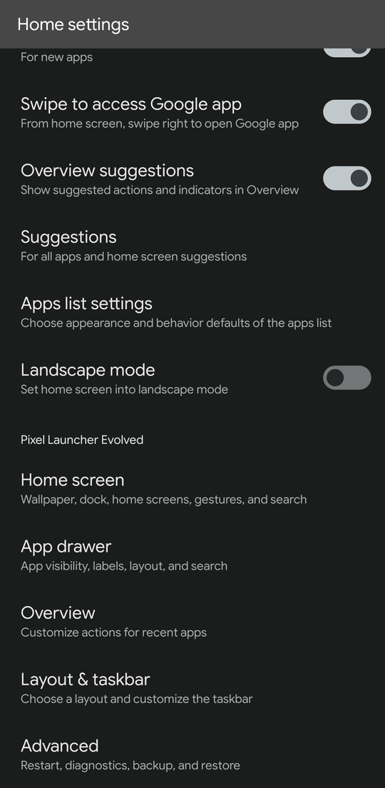
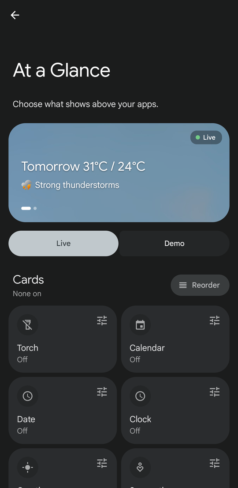
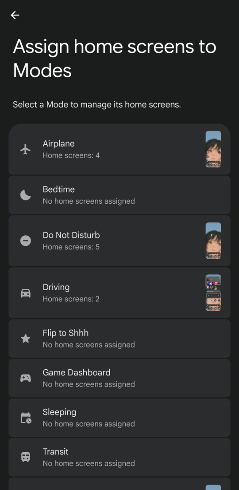
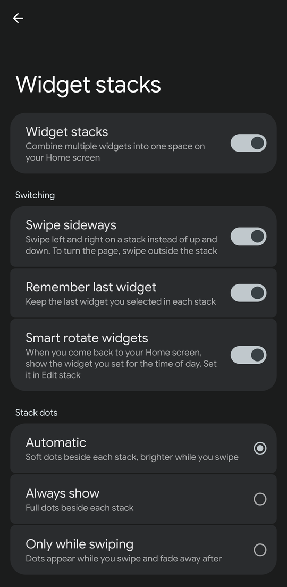

<div align="center">


# Pixel Launcher Evolved

**The controls Pixel Launcher doesn't ship, right inside its own Home settings.**

[](https://github.com/MrxSiN/PixelLauncherEvolved/releases)
[](https://github.com/MrxSiN/PixelLauncherEvolved/releases)
[](#requirements)
[](https://github.com/sponsors/MrxSiN)

</div>

<table>
<tr>
<td width="25%" align="center"><br><sub>Home settings</sub></td>
<td width="25%" align="center"><br><sub>At a Glance</sub></td>
<td width="25%" align="center"><br><sub>Home screens per Mode</sub></td>
<td width="25%" align="center"><br><sub>Widget stacks</sub></td>
</tr>
</table>

Long press an empty part of the home screen → **Home settings** → **Pixel Launcher Evolved**.
There is no separate app: every option sits in the launcher's own settings, drawn like Android 17.

## Features

**Home screen**
- **At a Glance**: live preview, with cards and extras you choose (calendar, notifications, any widget,
  screen time, battery, alarm and more), when each one shows (time, charging, music, Wi-Fi…), and
  a Demo to try them. On every home screen, or per Mode. Touch and hold At a Glance → **Customize**.
- **Home screens per Mode**: Bedtime, Driving, Work… each gets its own home screens, plus hidden
  apps, icon pack, blur, tint and At a Glance while it's on. **Reorder home screens** by dragging.
- **Widget stacks**: several widgets in one place; swipe to switch, smart rotate by time of day.
- **Dock**: hide it or choose how many icons. **Blur wallpaper**, **double tap to sleep** (home or status bar).

**Wallpaper & style**
- **Custom grid**, **icon size** and **icon packs**, applied through the launcher's own icon pipeline.

**App drawer**
- **Columns**, **hidden apps**, **app labels** (rename or hide per app), and which **search result**
  groups show; open web results in the browser you pick.

**Overview & taskbar**
- **Bubble**, **split screen** and **Clear all** on Recents; **layout modes** (taskbar only,
  Overview only, full tablet).

**Safety**
- **Safe Mode** after a crash loop, **layout recovery**, **backup and restore** of every setting,
  **compatibility & diagnostics**, and an **update check** (Advanced; on by default).

## Requirements

| | |
|---|---|
| **Android** | 17 (tested on `CP4A.261105.040.A1`, November 2026, and `CP3A.261005.005`) |
| **Launcher** | Pixel Launcher `com.google.android.apps.nexuslauncher` (tested on 907) |
| **Framework** | [Vector](https://github.com/JingMatrix/Vector) 2.2+ or any libxposed API 101+ framework |
| **Root** | Only for Double tap to sleep, Mode home screens and Layout recovery |

## Install

1. Install the APK from [Releases](https://github.com/MrxSiN/PixelLauncherEvolved/releases).
2. Enable **Pixel Launcher Evolved** in your Xposed manager (its scope is preset).
3. Force-stop Pixel Launcher once, then open Home settings.

Later updates need no force-stop: the launcher restarts itself the next time the screen goes off.
Before removing the module, use **Restore standalone widgets** (Widget stacks) and set the dock
back to Default, or Pixel Launcher will drop what only the module could hold.

## Compatibility

On every launcher start the module checks every launcher member it relies on and turns off any
tweak whose members are missing, instead of crashing. **Advanced → Compatibility & diagnostics**
shows the result; include its report when you [open an issue](https://github.com/MrxSiN/PixelLauncherEvolved/issues).

The update check asks GitHub once per launcher start, through the module's own app (Pixel Launcher
has no Internet access). Nothing about you or your phone is sent.

## Build

```bash
./gradlew testDebugUnitTest assembleRelease
```

Release signing reads `ANDROID_KEYSTORE_PATH`, `ANDROID_KEYSTORE_ALIAS`, `ANDROID_KEYSTORE_PASSWORD`
and `ANDROID_KEY_PASSWORD`. `scripts/check-project.sh` runs the checks CI enforces.

## Documentation

[Changelog](CHANGELOG.md) · [Hook notes](HOOK_NOTES.md) · [Migration](MIGRATION.md) ·
[Behaviour parity](BEHAVIOR_PARITY.md) · [Performance](PERFORMANCE.md) ·
[Optimization ledger](OPTIMIZATION_LEDGER.md) · [Publishing](PUBLISHING.md)

## Support

If the module is useful to you, you can [sponsor its development on GitHub](https://github.com/sponsors/MrxSiN).

## Credits

[DexKit](https://github.com/LuckyPray/DexKit) (LGPL-3.0) finds launcher members again after an update renames them ·
[libxposed API](https://github.com/libxposed/api), [Vector](https://github.com/JingMatrix/Vector) and
[LSPosed](https://github.com/LSPosed/LSPosed) · [FlatBuffers](https://github.com/google/flatbuffers) (Apache-2.0) ·
[AOSP Launcher3](https://android.googlesource.com/platform/packages/apps/Launcher3/) ·
At a Glance sources rewritten from [Smartspacer](https://github.com/KieronQuinn/Smartspacer) (GPL-3.0).

<div align="center">

**GPL-3.0** · [`LICENSE`](LICENSE) · [`NOTICE.md`](NOTICE.md)

</div>
